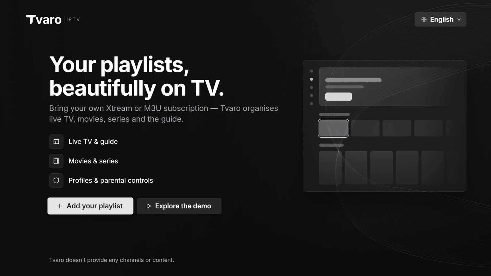
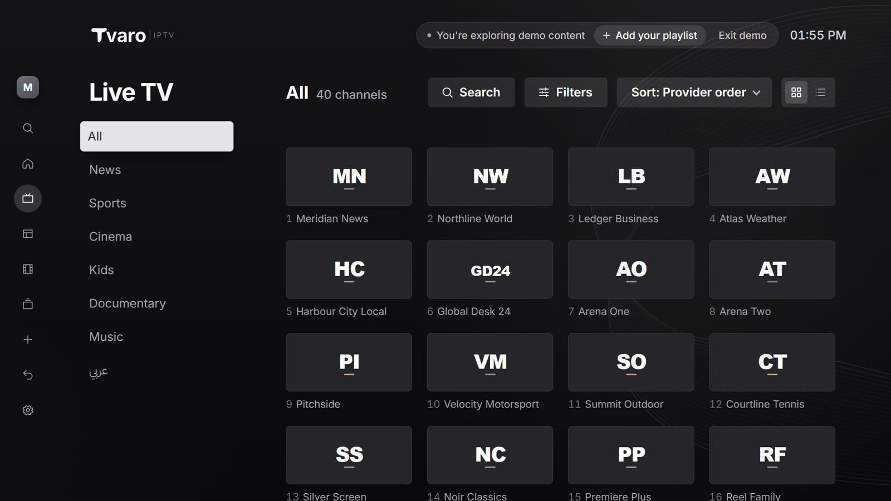
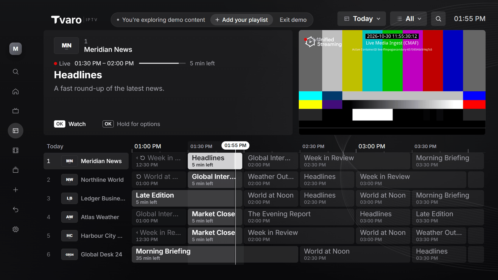
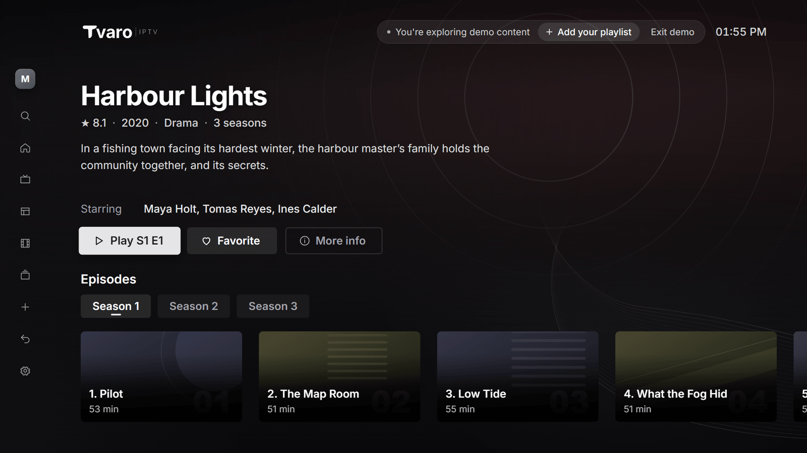
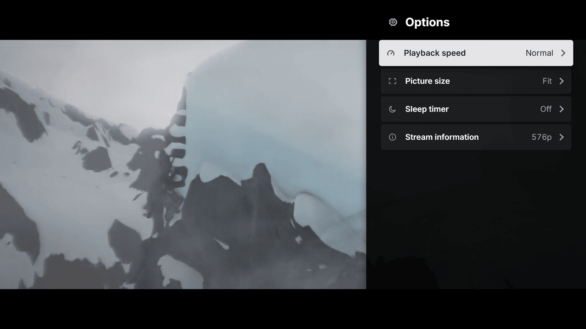
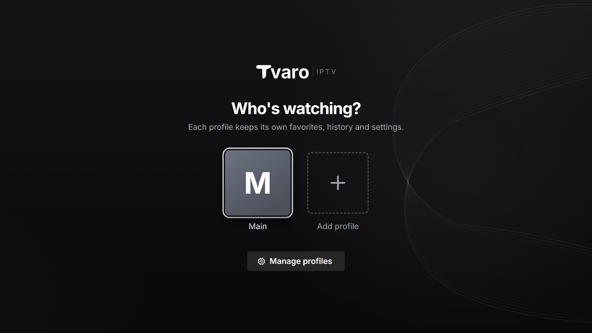
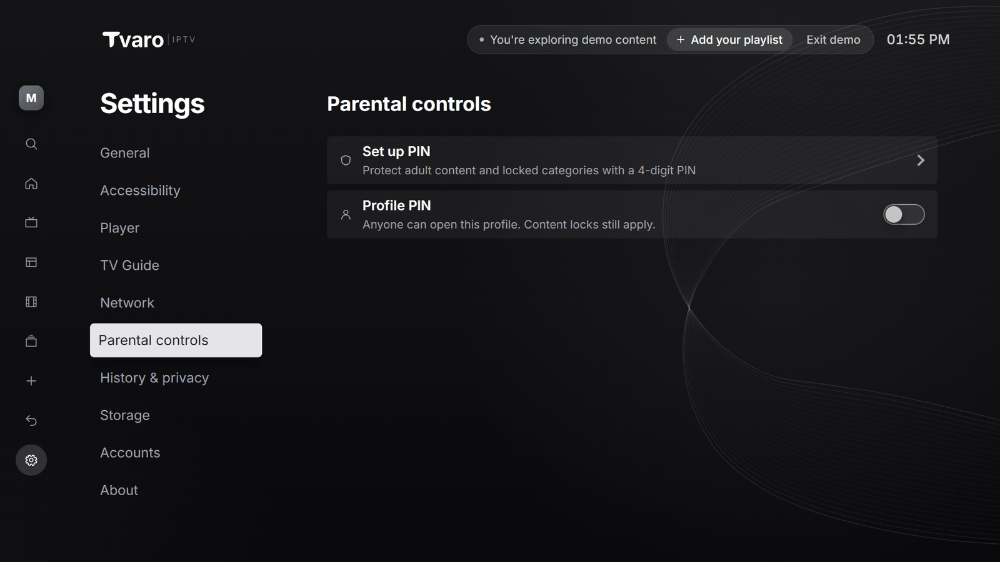
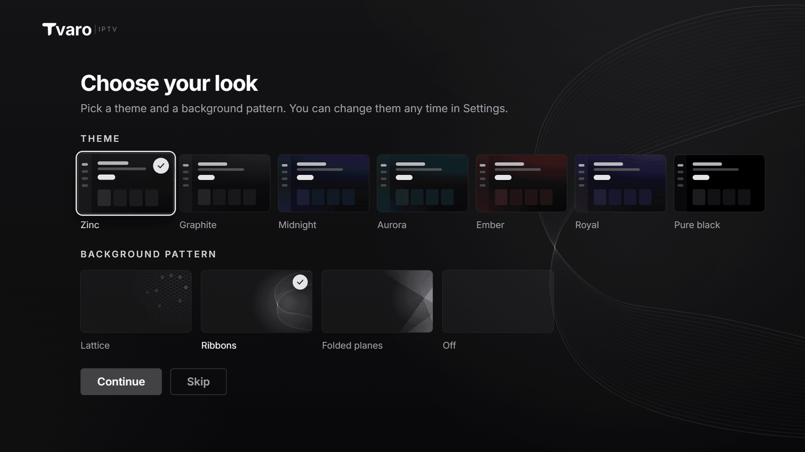
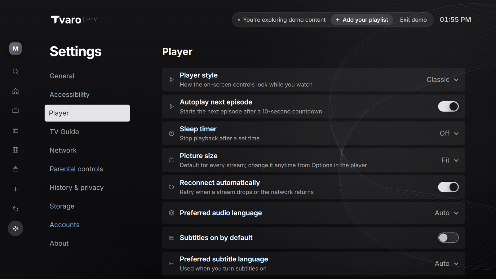
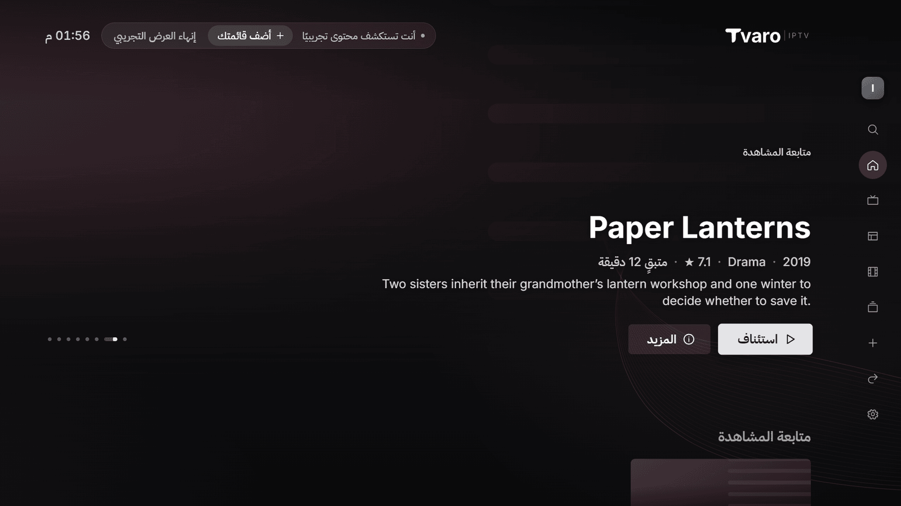

<p align="center">
  <picture>
    <source media="(prefers-color-scheme: dark)" srcset=".github/assets/lockup-iptv-mono-light.svg">
    <source media="(prefers-color-scheme: light)" srcset=".github/assets/lockup-iptv-mono-dark.svg">
    
  </picture>
</p>

<p align="center">
  Bring your own Xtream or M3U subscription — Tvaro organises live TV, movies, series and the guide.
</p>

<p align="center">
  <a href="https://github.com/tvaro-lab/tvaro-iptv-releases/releases/latest"></a>
  <a href="https://github.com/tvaro-lab/tvaro-iptv-releases/releases"></a>
</p>

<p align="center">
  
</p>

Tvaro IPTV Player is a media player for IPTV sources you are authorised to access. It is designed for the big screen and a remote first, and works just as well with a keyboard and mouse on the desktop.

> [!IMPORTANT]
> Tvaro does not provide any channels, playlists or content. You need your own subscription or playlist from a provider you are authorised to use.

## Download

Get the installer for your system from the [latest release](https://github.com/tvaro-lab/tvaro-iptv-releases/releases/latest). File names include the version number.

| Platform              | Package                     | Link                                                                               |
| --------------------- | --------------------------- | ---------------------------------------------------------------------------------- |
| Windows 10/11 (x64)   | Installer (`.exe`)          | [Latest release](https://github.com/tvaro-lab/tvaro-iptv-releases/releases/latest) |
| macOS (Apple Silicon) | Disk image (`.dmg`)         | [Latest release](https://github.com/tvaro-lab/tvaro-iptv-releases/releases/latest) |
| macOS (Apple Silicon) | App archive (`.app.tar.gz`) | [Latest release](https://github.com/tvaro-lab/tvaro-iptv-releases/releases/latest) |
| Linux (x64)           | Debian / Ubuntu (`.deb`)    | [Latest release](https://github.com/tvaro-lab/tvaro-iptv-releases/releases/latest) |
| Linux (x64)           | Fedora / RHEL (`.rpm`)      | [Latest release](https://github.com/tvaro-lab/tvaro-iptv-releases/releases/latest) |
| Linux (x64)           | AppImage (`.AppImage`)      | [Latest release](https://github.com/tvaro-lab/tvaro-iptv-releases/releases/latest) |
| Samsung TV (Tizen)    | —                           | Coming soon                                                                        |
| LG TV (webOS)         | —                           | Coming soon                                                                        |
| Android / Fire OS     | —                           | Coming soon                                                                        |

The `.sig` files and `latest.json` in each release are used by the built-in updater. You don't need to download them.

### System requirements

- **Windows:** Windows 10 or 11, 64-bit, with Microsoft Edge WebView2. WebView2 is preinstalled on Windows 11; on Windows 10 the installer downloads it if it is missing.
- **macOS:** macOS 11 Big Sur or later on Apple Silicon (M1 or newer).
- **Linux:** a 64-bit distribution with WebKitGTK 4.1 (`libwebkit2gtk-4.1`).

## Installation

Tvaro builds are not code-signed yet, so your system may warn you the first time you open the app. Updates are signed and verified separately (see [Updates](#updates)).

### Windows

1. Run `Tvaro_<version>_x64-setup.exe`. It installs for your user account and doesn't need administrator rights.
2. If Microsoft Defender SmartScreen shows "Windows protected your PC", select **More info**, then **Run anyway**.

### macOS

1. Open `Tvaro_<version>_aarch64.dmg` and drag **Tvaro** into **Applications**.
2. The first time, right-click (or Control-click) Tvaro in Applications and choose **Open**, then **Open** again. On recent macOS versions, try to open the app once, then go to **System Settings › Privacy & Security** and select **Open Anyway**.
3. If macOS says the app "is damaged and can't be opened", remove the download quarantine flag in Terminal, then open it again:

   ```sh
   xattr -dr com.apple.quarantine /Applications/Tvaro.app
   ```

### Linux

Debian, Ubuntu and derivatives:

```sh
sudo apt install ./Tvaro_<version>_amd64.deb
```

Fedora, RHEL and derivatives:

```sh
sudo dnf install ./Tvaro-<version>-1.x86_64.rpm
```

AppImage (no installation needed):

```sh
chmod +x Tvaro_<version>_amd64.AppImage
./Tvaro_<version>_amd64.AppImage
```

## Updates

The desktop app keeps itself up to date from the latest release in this repository. It checks shortly after launch and then every 6 hours, never interrupts playback, and lets you read what's new before you update. Every update is signed, and the app refuses any update that isn't signed with the Tvaro release key.

You can check for updates or turn automatic updates off in **Settings › About**. If an update can't be installed automatically on your system, download the new version from the [latest release](https://github.com/tvaro-lab/tvaro-iptv-releases/releases/latest) and install it over the current one; your settings and accounts are kept.

## Features

<table>
  <tr>
    <td width="50%" valign="top">
      <br>
      <b>Easy start</b><br>
      Add an Xtream Codes login or an M3U playlist with an optional XMLTV guide step by step, or explore the built-in demo first.
    </td>
    <td width="50%" valign="top">
      <br>
      <b>Live TV</b><br>
      Categories, favourites and custom groups, sorting by number or name, quick channel switching, and timeshift on channels with catch-up.
    </td>
  </tr>
  <tr>
    <td width="50%" valign="top">
      <br>
      <b>TV guide</b><br>
      Three layouts: Preview with a live mini player, Full grid and Split. Catch-up on supported channels, reminders for upcoming programmes, and search.
    </td>
    <td width="50%" valign="top">
      <br>
      <b>Movies and series</b><br>
      Details pages with trailers, resume where you left off, Continue Watching, seasons and episodes, Up Next and Skip intro.
    </td>
  </tr>
  <tr>
    <td width="50%" valign="top">
      <br>
      <b>Player</b><br>
      Audio and subtitle tracks, external subtitles with adjustable delay, playback speed, picture size, a sleep timer and four player styles.
    </td>
    <td width="50%" valign="top">
      <br>
      <b>Profiles</b><br>
      Up to five profiles per account, each with its own favourites, watch history, language and track preferences, and an optional PIN.
    </td>
  </tr>
  <tr>
    <td width="50%" valign="top">
      <br>
      <b>Parental controls</b><br>
      A 4-digit PIN that locks adult content and chosen categories, hidden from Home, the guide and search until unlocked.
    </td>
    <td width="50%" valign="top">
      <br>
      <b>Themes</b><br>
      Seven themes and optional background patterns, chosen per profile.
    </td>
  </tr>
  <tr>
    <td width="50%" valign="top">
      <br>
      <b>Settings</b><br>
      Preferred audio and subtitle languages, subtitle appearance, guide layout, playlist and guide refresh schedules, watch history and storage.
    </td>
    <td width="50%" valign="top">
      <br>
      <b>English and Arabic</b><br>
      A full right-to-left layout in Arabic, with search that understands Arabic letter variants.
    </td>
  </tr>
</table>

Also included:

- **Keyboard and mouse:** remote-style navigation with the arrow keys, plus mouse and scroll wheel support. F11 toggles fullscreen and media keys control playback.
- **Search:** one search across channels, movies and series.
- **Multiple accounts:** add several sources and switch between them.

Screenshots show the built-in demo library. The player screenshot shows _Sintel_ © Blender Foundation, [CC BY 3.0](https://creativecommons.org/licenses/by/3.0/).

### Limitations

- No recording (PVR), picture-in-picture or multiview.
- Playlists, guides and reminders only refresh while the app is open.
- For security, the desktop app doesn't connect to servers on your local network (private IP addresses).

## Privacy

- **No account:** you don't sign up for anything to use Tvaro.
- **No tracking:** the app contains no analytics, telemetry or advertising.
- **Your data stays on your device:** accounts, favourites, watch history and settings are stored locally. Saved logins and playlist links are encrypted on the device.
- **Network access:** the app connects to the providers you add (and the artwork links they supply), to GitHub to check for updates, and to public test streams when you use the demo. Trailers open in your default browser.

## Legal

Tvaro is a media player only. It does not provide, sell, host or link to any channels, playlists or other content, and it is not affiliated with any IPTV provider. You are responsible for making sure you have the right to access the sources you add.

## Support

Found a bug or have a suggestion? [Open an issue](https://github.com/tvaro-lab/tvaro-iptv-releases/issues/new/choose). Please include your platform and app version (shown in **Settings › About**). We can't help with provider accounts, subscriptions or channel availability.

## About this repository

This repository only hosts releases; source is private. Issues are welcome here.

© 2026 Tvaro. All rights reserved.
