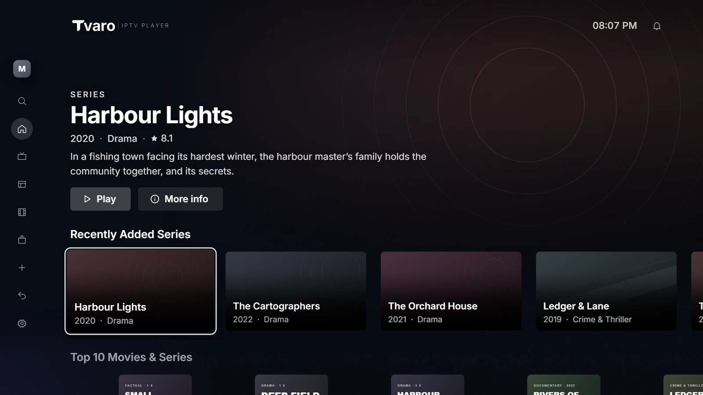

  <a href="https://tvaro.live">
    <picture>
      <source media="(prefers-color-scheme: dark)" srcset="assets/logo-light.svg">
      <source media="(prefers-color-scheme: light)" srcset="assets/logo-dark.svg">
      
    </picture>
  </a>

  A calm, remote-first IPTV player for your own subscription.

  <a href="https://tvaro.live/download/"><b>Download</b></a>
  &nbsp;·&nbsp;
  <a href="https://tvaro.live/docs/"><b>Help</b></a>
  &nbsp;·&nbsp;
  <a href="https://tvaro.live/changelog/"><b>What's new</b></a>

  

Get Tvaro IPTV Player for Windows, macOS, Linux, Android, and Samsung and LG TVs at **[tvaro.live](https://tvaro.live)**.

> [!IMPORTANT]
> Tvaro IPTV Player is a media player only. It doesn't include, sell or recommend any channels, playlists or subscriptions. Use it only with sources you're authorised to access.

© 2026 Tvaro. All rights reserved. [Privacy](https://tvaro.live/privacy/) · [Terms](https://tvaro.live/terms/)
