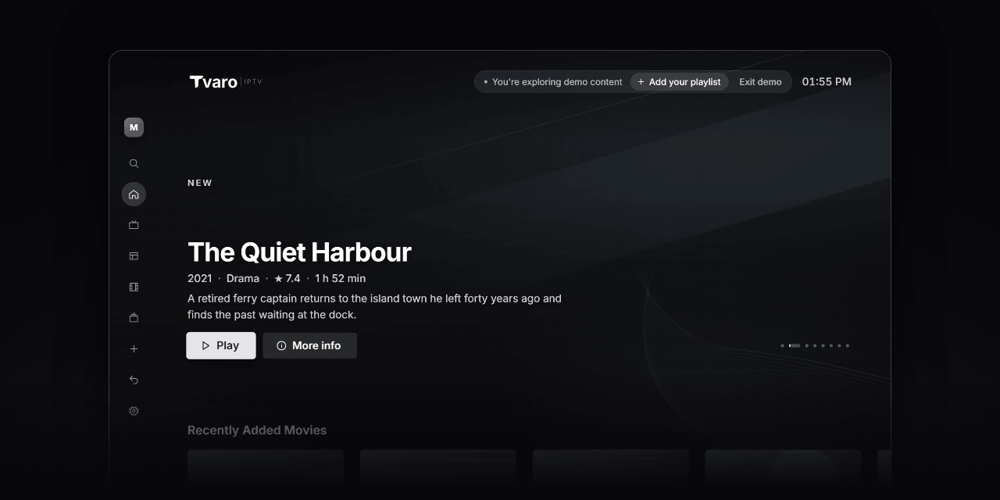

  <picture>
    <source media="(prefers-color-scheme: dark)" srcset=".github/assets/lockup-iptv-mono-light.svg">
    <source media="(prefers-color-scheme: light)" srcset=".github/assets/lockup-iptv-mono-dark.svg">
    
  </picture>

  Bring your own Xtream or M3U subscription — Tvaro organises live TV, movies, series and the guide.

  
  

  

Tvaro IPTV Player is a media player for IPTV sources you are authorised to access. It is designed for the big screen and a remote first, and works just as well with a keyboard and mouse on the desktop.

> [!IMPORTANT]
> Tvaro does not provide any channels, playlists or content. You need your own subscription or playlist from a provider you are authorised to use.

## Download

Get the installer for your system from the [latest release](https://github.com/tvaro-lab/tvaro-iptv-releases/releases/latest). File names include the version number. See the [changelog](CHANGELOG.md) for what changed in each version.

| Platform              | Package                     | Link                                                                               |
| --------------------- | --------------------------- | ---------------------------------------------------------------------------------- |
| Windows 10/11 (x64)   | Installer (`.exe`)          | [Latest release](https://github.com/tvaro-lab/tvaro-iptv-releases/releases/latest) |
| macOS (Apple Silicon) | Disk image (`.dmg`)         | [Latest release](https://github.com/tvaro-lab/tvaro-iptv-releases/releases/latest) |
| Linux (x64)           | Debian / Ubuntu (`.deb`)    | [Latest release](https://github.com/tvaro-lab/tvaro-iptv-releases/releases/latest) |
| Linux (x64)           | Fedora / RHEL (`.rpm`)      | [Latest release](https://github.com/tvaro-lab/tvaro-iptv-releases/releases/latest) |
| Linux (x64)           | AppImage (`.AppImage`)      | [Latest release](https://github.com/tvaro-lab/tvaro-iptv-releases/releases/latest) |
| Samsung TV (Tizen)    | —                           | Coming soon                                                                        |
| LG TV (webOS)         | —                           | Coming soon                                                                        |
| Android / Fire OS     | —                           | Coming soon                                                                        |

The `.sig` files and `latest.json` in each release are used by the built-in updater. You don't need to download them.

### System requirements

- **Windows:** Windows 10 or 11, 64-bit, with Microsoft Edge WebView2. WebView2 is preinstalled on Windows 11; on Windows 10 the installer downloads it if it is missing.
- **macOS:** macOS 11 Big Sur or later on Apple Silicon (M1 or newer).
- **Linux:** a 64-bit distribution with WebKitGTK 4.1 (`libwebkit2gtk-4.1`).

## Installation

Builds are not code-signed yet, so your system may warn you the first time.

- **Windows:** run the installer. If SmartScreen appears, select **More info**, then **Run anyway**.
- **macOS:** drag **Tvaro** into **Applications**, then right-click it and choose **Open**. If macOS says the app is damaged, run `xattr -dr com.apple.quarantine /Applications/Tvaro.app`.
- **Linux:** `sudo apt install ./Tvaro_<version>_amd64.deb`, `sudo dnf install ./Tvaro-<version>-1.x86_64.rpm`, or make the AppImage executable and run it.

The desktop app updates itself automatically.

## Support

[Open an issue](https://github.com/tvaro-lab/tvaro-iptv-releases/issues/new/choose) with your platform and app version (**Settings › About**).

---

This repository only hosts releases. © 2026 Tvaro. All rights reserved.
